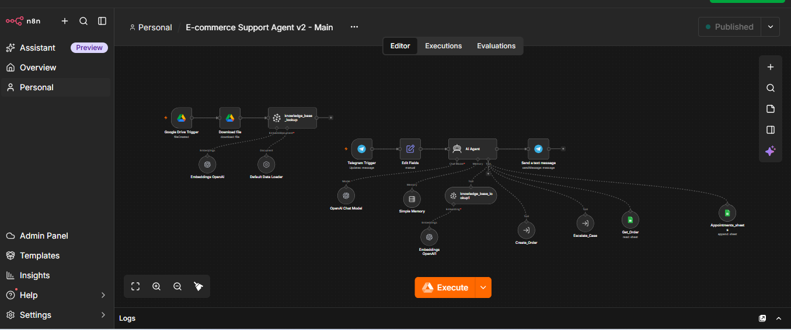
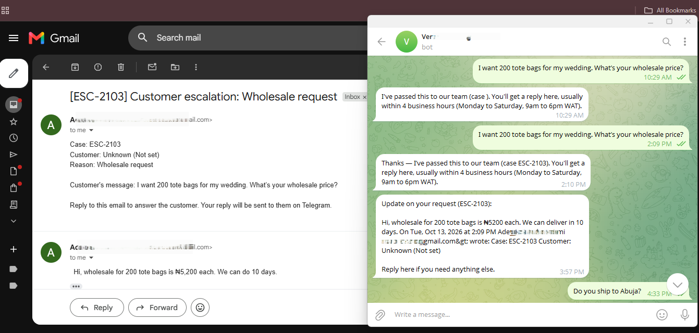

# E-commerce Support Agent: RAG + n8n + Telegram

An AI customer support agent for an online store, built in n8n. Customers chat with it on Telegram to get answers from the store's own documents, place orders, check order status, book showroom appointments, and escalate to a human when the bot shouldn't guess. Escalations are tracked as cases, and the loop is closed: the owner's email reply is relayed to the customer, and unanswered cases are chased.

> Built as a practice project for a fictional client, **Verdant Homegoods** (a sustainable home and kitchen store in Lagos, Nigeria). All business data, names and contact details in this repo are made up.



## Versions

| | v1 | v2 |
|---|---|---|
| Answers from the knowledge base (RAG) | Yes | Yes |
| Order IDs | Generated by the LLM | Generated in code, checked against the sheet for duplicates |
| Timestamps and payment status | Typed by the customer or guessed by the model | Stamped by the workflow (Lagos time) |
| Escalation | Email sent, then forgotten | Tracked case (`ESC-####`) with status, Gmail thread ID and chat ID |
| Owner's reply | Never reaches the customer | Relayed to the customer on Telegram, case marked Resolved |
| Unanswered escalations | Nothing happens | Two nudges to the owner, then a human handoff and an honest delay message to the customer |

v2 came out of feedback on v1: anything unique or traceable (IDs, timers, reply tracking) should be owned by deterministic code, and the LLM should only draft the words.



## What it does

- **Answers from the knowledge base:** shipping rates, returns policy, FAQs and product details are retrieved from a Pinecone vector index instead of being guessed by the model.
- **Creates orders:** collects the details in conversation, confirms the summary with the customer, then calls a sub-workflow that generates the Order ID (`VHG-####`) and writes the row to Google Sheets.
- **Looks up orders** by Order ID.
- **Books showroom appointments** into a Google Sheet.
- **Escalates with a case ID:** wholesale requests, discounts, custom orders, complaints and out-of-policy refunds create a tracked case and email the owner.
- **Closes the loop:** when the owner replies to the escalation email, the customer receives the answer on Telegram and the case is marked Resolved.
- **Chases silence:** during business hours (Mon to Sat, 9am to 6pm WAT) the owner gets a nudge at 4 and 8 business hours. After that the case becomes `Needs human`, the customer gets a delay message, and nudging stops.
- **Self-updating knowledge:** adding a file to a Google Drive folder re-indexes it automatically.

## Architecture (v2)

Five workflows:

| Workflow | Trigger | Job |
|---|---|---|
| Main agent | Telegram message | AI Agent with OpenAI chat model, memory, Pinecone retrieval and tools; also the Drive-to-Pinecone ingestion flow |
| Create Order (sub-workflow) | Called by the agent | Reads existing IDs, generates a unique `VHG-####` ID and Lagos timestamp in a Code node, appends the order row, returns the ID |
| Escalate Case (sub-workflow) | Called by the agent | Generates `ESC-####`, emails the owner with the case ID in the subject, logs the case with the Gmail thread ID and chat ID |
| Escalation Reply Watcher | Gmail trigger (every minute) | Matches a reply to its case by thread ID, sends the owner's answer to the customer on Telegram, marks the case Resolved |
| Escalation Reminder | Schedule (hourly) | Computes business hours open, sends nudges, hands off to a human after the second nudge |

Agent tools: `knowledge_base_lookup1` (Pinecone), `Create_Order`, `Get_Order`, `Appointments_sheets`, `Escalate_Case`.

## Tech stack

n8n, OpenAI (chat model and embeddings), Pinecone, Telegram Bot API (BotFather), Google Drive, Google Sheets, Gmail.

## Google Sheets structure

**Orders:** Order ID, Date/Time, Customer Name, Telegram Username/Chat ID, Phone Number, Delivery Address, Products Ordered, Order Total, Payment Method, Payment Status, Shipping Zone, Gift Wrap, Order Status

**Appointments:** Requested Date/Time, Customer Name, Telegram Username, Phone Number, Status, Notes

**Escalations:** Case ID, Date/Time, Customer Telegram Username, Chat ID, Customer's Question, Reason for Escalation, Status (`Open`, `Needs human`, `Resolved`), Assigned To, Gmail Thread ID, Reminder Sent (legacy), Resolution, Nudge Count

## Repository layout

```
.
├── README.md
├── v1-workflow.json                      original build
├── v2/                                   five v2 workflows
├── docs/                                 screenshots
└── VerdantHomegoods_Knowledgebase.pdf    sample business knowledge base
```

## Setup

1. Import the five v2 workflows into n8n.
2. Create credentials for OpenAI, Pinecone, Telegram (token from BotFather), Google Drive, Google Sheets and Gmail, and attach them to the nodes.
3. Create a Pinecone index and select it in both the ingestion and retrieval nodes. Both must use the same embedding model.
4. Create the Google Sheets above and point each sheet node at the right tab.
5. add the documents from knowledge-base/” to “add VerdantHomegoods_Knowledgebase.pdf from this repo.
6. In the two sub-workflow tool nodes of the main agent, select the imported Create Order and Escalate Case workflows.
7. Add your own chat ID in the reminder workflow's Telegram nodes and your own email in the Escalate Case email node.
8. Paste the agent system message (role, rules, tool usage, boundaries, knowledge summary) into the AI Agent node, then publish the workflows.

## Testing

Tested with scripted conversations covering retrieval (delivery times, COD rules, dishwasher-safe checks), hallucination traps, full order creation with correct totals, order lookup including a non-existent ID, appointment booking with business-day rules, escalation with case IDs, the owner reply relayed to the customer, and the nudge sequence through to handoff.

## Design decisions

- **The LLM drafts the words; code owns everything traceable.** Order IDs, case IDs, timestamps, deadlines and reply matching are generated or checked in deterministic nodes, never by the model. The agent only relays what the tools return.
- **Two nudges, then a human.** An unanswered case is not chased forever. The owner gets a nudge at 4 and at 8 business hours (Monday to Saturday, 9am to 6pm WAT only, so nobody is pinged overnight). After that the case becomes `Needs human`, nudging stops, and the customer receives an honest delay message. This keeps the watchdog from spamming the owner.
- **Closing the loop, not just sending.** An escalation email is tied to a case ID and Gmail thread ID. A separate watcher matches the owner's reply to the case, forwards it to the customer, and closes the case.
- **Case state store.** Today the state lives in Google Sheets, which is fine for demo volume. It has API quotas, no transactions, and a failed scheduled scan fails silently. For production, the state would move to Postgres (for example Supabase) with `status`, `nudge_count` and an indexed `due_at` column, or to a delayed-job queue with a TTL per deadline, plus an error workflow that alerts when the watcher itself fails.

## Known limitations and next steps

- **Case state lives in Google Sheets.** That is fine for demo volume but has quotas, no transactions, and a failed scan fails silently. A production version would keep cases in Postgres (for example Supabase) with a `due_at` column, or use a delayed-job queue, plus an error workflow that alerts when the watcher itself fails.
- **Payment status** should be confirmed by a payment webhook (for example Paystack), not typed in chat.
- **Backup owner:** the second nudge goes to the owner only; a backup contact is a straightforward extension.
- **Supabase (pgvector) version** of the retrieval layer is planned for comparison with Pinecone.

## Author

[Adeyemi Daniel], Automation Engineer. [https://www.linkedin.com/in/adeyemi-daniel-akinsanmi-a69a873a5/]
